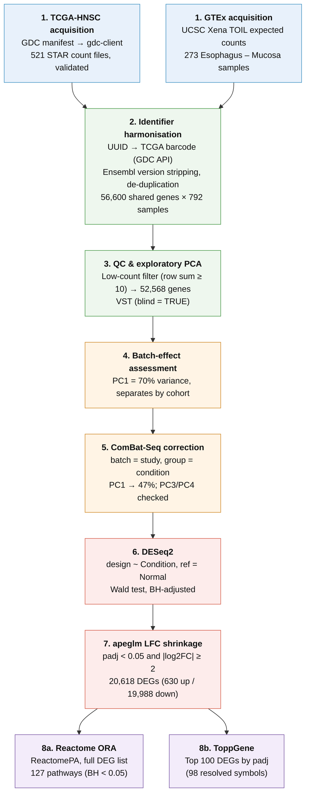
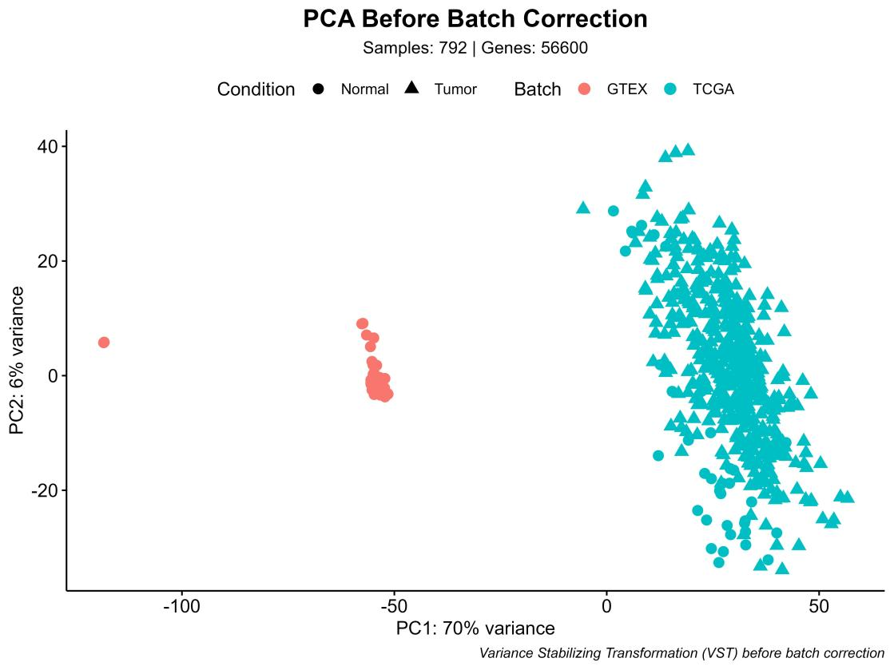
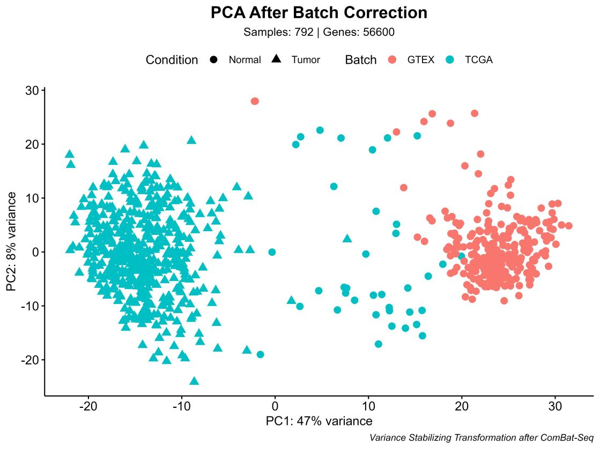
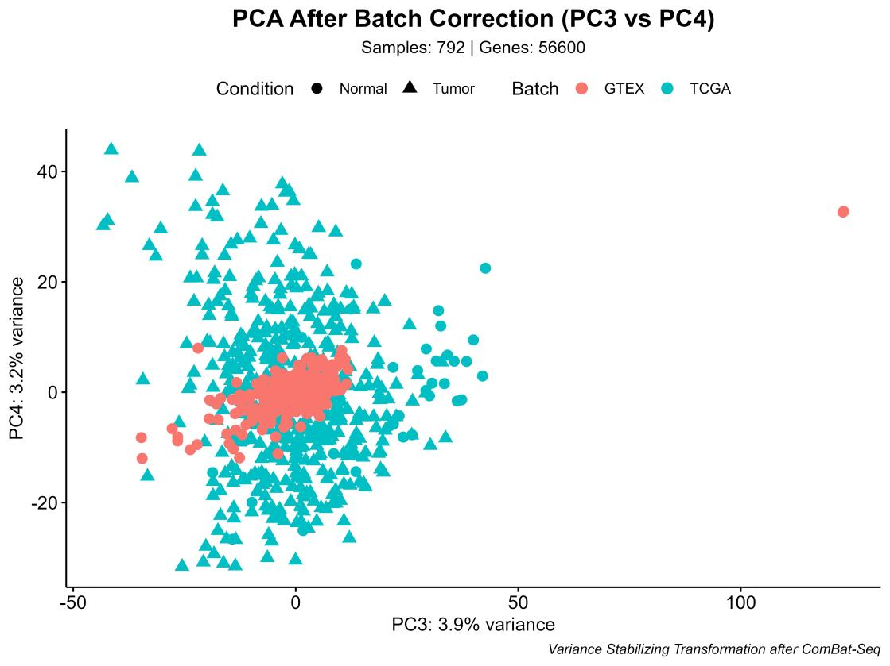
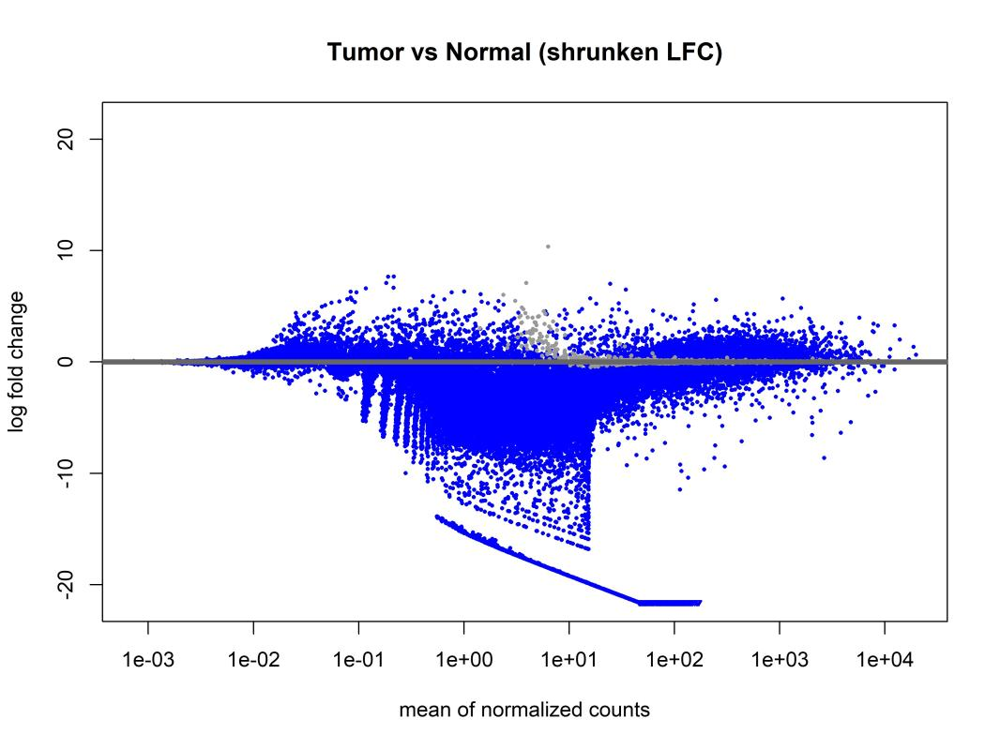
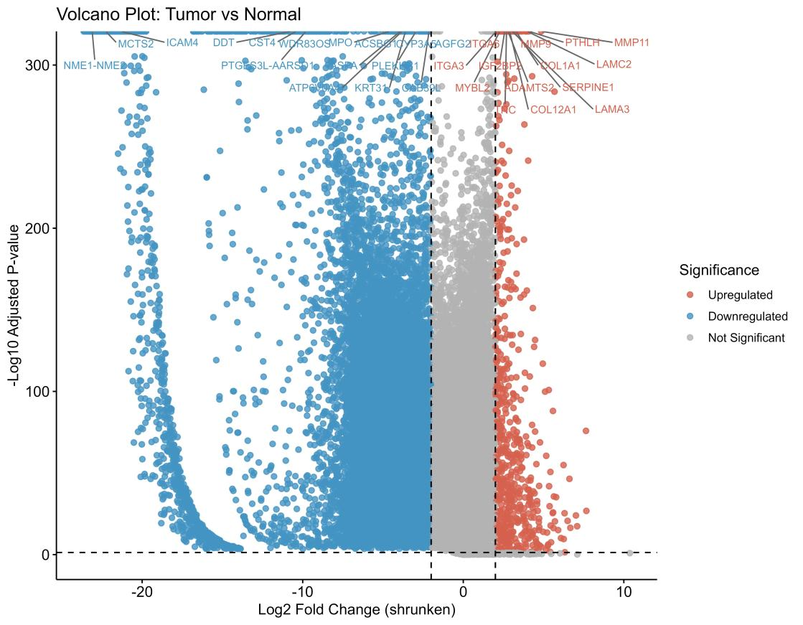
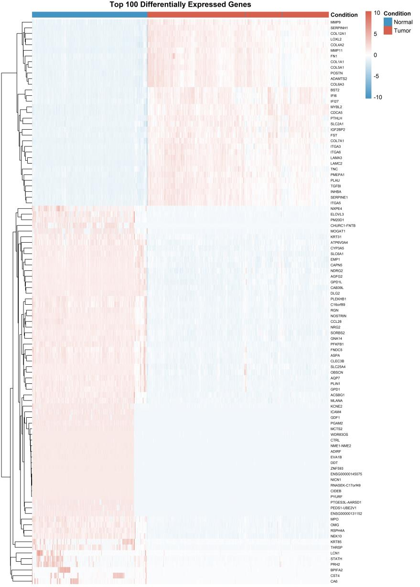
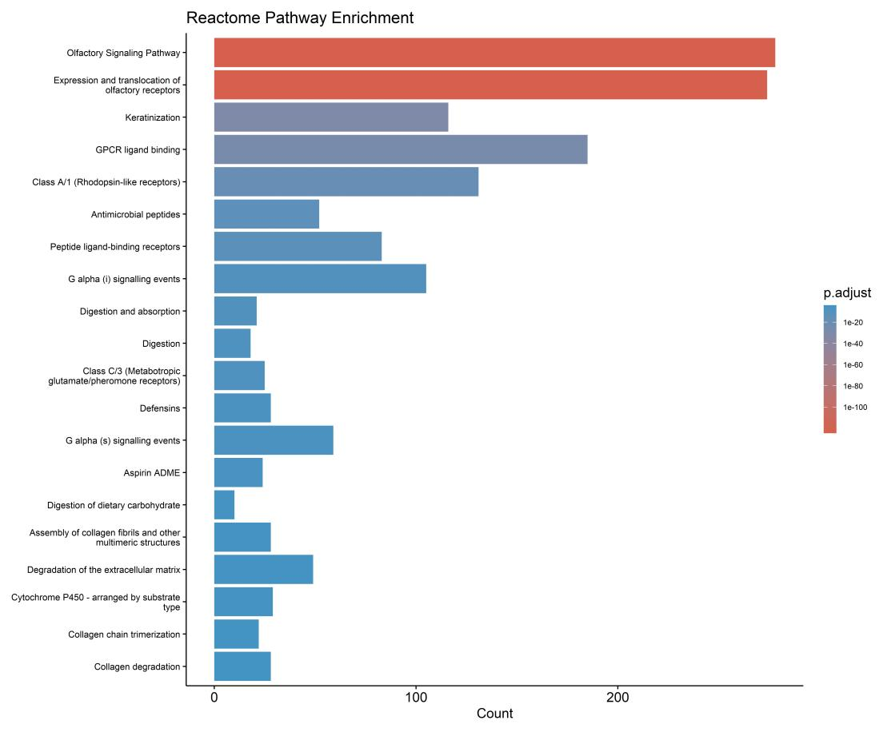

<div align="center">

# Differential Gene Expression Analysis of Head and Neck Squamous Cell Carcinoma Using RNA Sequencing Data

**A cross-cohort transcriptomic pipeline integrating TCGA-HNSC tumours with GTEx normal mucosa: harmonisation, ComBat-Seq batch correction, DESeq2 differential expression and dual-tool pathway enrichment**

[](https://www.r-project.org/)
[](https://bioconductor.org/)
[](#dataset-information)
[](LICENSE)

Summer internship project &nbsp;·&nbsp; St. John's Research Institute, Bengaluru &nbsp;·&nbsp; 2026

[**Read the full report (PDF)**](report/Tanish_N_Internship_Report_Corrected_01_11.pdf) &nbsp;·&nbsp;
[Methodology](docs/methodology.md) &nbsp;·&nbsp;
[Workflow](docs/workflow.md) &nbsp;·&nbsp;
[Source code](src/) &nbsp;·&nbsp;
[Results](results/)

[Special Thanks to my Friend : **[Hemalaskshmi.P](https://github.com/Hemapushparaj)**]

</div>

---

## Table of contents

1. [Project overview](#project-overview)
2. [Internship details](#internship-details)
3. [Research objectives](#research-objectives)
4. [Dataset information](#dataset-information)
5. [Computational workflow](#computational-workflow)
6. [Key findings](#key-findings)
7. [Scientific figure gallery](#scientific-figure-gallery)
8. [Technology stack](#technology-stack)
9. [Repository structure](#repository-structure)
10. [Reproducibility](#reproducibility)
11. [Limitations](#limitations)
12. [Future directions](#future-directions)
13. [Acknowledgements](#acknowledgements)
14. [Citation and licence](#citation-and-licence)

---

## Project overview

Head and neck squamous cell carcinoma (HNSC) arises in the mucosal epithelium of the oral cavity, oropharynx, hypopharynx and larynx. It is one of the most common cancer groups worldwide, and its burden is especially high in South and Southeast Asia. A central aim of molecular work on HNSC is to describe how tumour tissue differs from the normal epithelium it arose from. Genes and pathways that separate the two states are candidate drivers, biomarkers and therapeutic targets.

**The cross-cohort challenge.** The Cancer Genome Atlas (TCGA) is the reference resource for HNSC transcriptomics, but it collected normal tissue only opportunistically. Of the 519 TCGA-HNSC samples used here, only 37 are normal, about 13 tumours for every normal sample. The Genotype-Tissue Expression (GTEx) project supplies hundreds of normal samples, but it does **not** sample oral or oropharyngeal mucosa, so a histologically related surrogate (Esophagus – Mucosa) has to be used. Combining the two resources introduces a second problem. GTEx contributes only normal samples and TCGA contributes almost only tumours, so **study of origin (batch) and biological condition are nearly the same variable**.

This project built and ran an end-to-end R/Bioconductor pipeline for that design and treated the batch-condition confound as a central object of analysis, not a footnote. The results are reported in full, including those best explained as artefacts. The pattern of which signals survive a change of analysis scope is itself the clearest evidence of what the design can support.

---

## Internship details

| | |
|---|---|
| **Project** | Differential Gene Expression Analysis of Head and Neck Squamous Cell Carcinoma (HNSC) Using RNA Sequencing Data |
| **Student** | Tanish N, III-Year B.Sc. Biotechnology |
| **Host institution** | St. John's Research Institute, St. John's National Academy of Health Sciences, Bengaluru |
| **Academic institution** | Department of Biotechnology, Indira Gandhi College of Arts and Science, Puducherry (affiliated to Pondicherry University) |
| **Supervisor** | Dr. Madhumathy G Nair, Assistant Professor, Department of Molecular Medicine, St. John's Research Institute, Bengaluru |
| **Co-guide** | Dr. Tesmine Martin, Research Consultant, St. John's Research Institute; Assistant Professor, Department of Biochemistry, St. Joseph's University |
| **Programme** | Summer internship under the NEP curriculum, Academic Year 2026–2027 |
| **Report** | [`report/Tanish_N_Internship_Report_Corrected_01_11.pdf`](report/Tanish_N_Internship_Report_Corrected_01_11.pdf) (68 pages) |

---

## Research objectives

**Aim:** To build and run a reproducible cross-cohort transcriptomic pipeline that integrates TCGA-HNSC tumour RNA-seq data with GTEx normal-tissue data, to identify the differentially expressed genes and enriched pathways that distinguish HNSC tumour tissue from normal squamous mucosa, and to assess how far the overlap between batch and condition limits the conclusions.

The objectives, as documented in Section 4.2 of the report, were to:

1. **Acquire and validate** gene-level RNA-seq counts for TCGA-HNSC from the Genomic Data Commons, and define the usable cohort by sample type.
2. **Acquire GTEx normal-tissue counts** on the same quantification scheme, choosing a histologically defensible surrogate for head and neck mucosa.
3. **Harmonise** sample identifiers, gene identifiers and metadata into one combined count matrix restricted to genes measured in both cohorts.
4. **Run quality control and exploratory PCA** to establish the dominant axes of variation before any statistical testing.
5. **Detect and quantify the batch effect** between the two studies, correct it with ComBat-Seq with condition protected, and assess the correction.
6. **Identify differentially expressed genes** with DESeq2 on the corrected matrix, using apeglm shrinkage and combined adjusted p-value and fold-change thresholds.
7. **Interpret the gene set** with Reactome enrichment of the full list and ToppGene enrichment of its most significant subset, and test whether enriched terms stay stable when the scope changes.
8. **Characterise the batch-condition confound** and separate the findings that are robust to it from those that are attributable to it.

---

## Dataset information

| Data source | Tissue label | Condition | Samples |
|---|---|---|---:|
| TCGA-HNSC (GDC, STAR – Counts) | HNSC primary tumour | Tumour | **482** |
| TCGA-HNSC (GDC, STAR – Counts) | Adjacent normal (Solid Tissue Normal) | Normal | **37** |
| GTEx (UCSC Xena TOIL recompute) | Esophagus – Mucosa (surrogate normal) | Normal | **273** |
| **Combined cohort** | | | **792** |

| Property | Value |
|---|---|
| TCGA files retrieved | 521 open-access STAR count files (482 Primary Tumour, 37 Solid Tissue Normal, 2 Metastatic; the 2 metastatic samples were excluded) |
| TCGA reference / gene model | hg38 / GENCODE v36; two GDC workflow versions present (506 + 15 files) |
| GTEx route | UCSC Xena TCGA-TARGET-GTEx hub (TOIL RNA-seq recompute, expected counts). The GTEx v11 RNASeQC release (1,366 Esophagus – Mucosa samples) was evaluated and rejected because its quantification pipeline differs from TCGA's |
| Genes per source | TCGA 60,660 · GTEx 60,498 |
| **Harmonised genes** (intersection) | **56,600** |
| Genes after low-count filter (row sum ≥ 10) | 52,568 |

**Batch × condition cross-tabulation, the central design constraint:**

| Batch | Normal | Tumour | Total |
|---|---:|---:|---:|
| TCGA | 37 | 482 | 519 |
| GTEx | 273 | **0** | 273 |
| **Total** | 310 | 482 | 792 |

The GTEx × Tumour cell is empty by construction. The 37 TCGA normal samples are the **only** samples that can empirically separate a batch effect from a condition effect.

---

## Computational workflow


<sub><i>Schematic drawn for this README from the Materials and Methods section of the report. It is not a figure from the report.</i></sub>

| Step | What was done | Script |
|---|---|---|
| **1. Data acquisition** | TCGA-HNSC STAR counts downloaded from the GDC using a manifest and validated (0 missing, 0 extra, 0 duplicated, 0 unreadable files; 60,660 genes in every file). GTEx Esophagus – Mucosa samples selected from the Xena phenotype table and extracted from the Xena expected-count matrix by header-indexed column selection. | [`01`](src/data_acquisition/01_TCGA_GDC_Acquisition_Validation_Parsing.R), [`02`](src/data_acquisition/02_HNSC_Annotation_Metadata_Pipeline.R), [`03`](src/data_acquisition/03_GTEx_Data_Preparation.R), [`04`](src/data_acquisition/04_GTEx_Esophagus_Mucosa_Metadata_Preparation.R) |
| **2. Harmonisation** | File UUIDs resolved to TCGA barcodes through the GDC `files` API. Barcodes truncated to 15 characters (sample level). Ensembl version suffixes stripped; 44 duplicate TCGA identifiers removed. Intersection of 56,600 genes; five-field metadata (Sample_ID, Condition, Batch, Tissue, Study). Every join checked with `stopifnot()`. | [`05`](src/preprocessing/05_Data_Harmonization_and_Integration.R) |
| **3. QC and exploratory PCA** | Counts rounded to integers. Genes with a total count below 10 removed (52,568 retained). Variance-stabilising transformation with `blind = TRUE`. PCA coloured by batch, shaped by condition. | [`06`](src/batch_correction/06_PCA_and_Batch_Effect_Analysis.R) |
| **4. Batch-effect assessment** | Batch × condition cross-tabulation; PC1 carried 70% of variance and separated TCGA from GTEx. | [`06`](src/batch_correction/06_PCA_and_Batch_Effect_Analysis.R) |
| **5. ComBat-Seq** | `sva::ComBat_seq` on raw counts with `batch = study` and `group = condition` (biology protected). Re-assessed on PC1/PC2 and PC3/PC4. Outlier sample identified and library sizes inspected. | [`06`](src/batch_correction/06_PCA_and_Batch_Effect_Analysis.R) |
| **6. DESeq2** | `~ Condition` with Normal as reference; median-of-ratios normalisation, empirical-Bayes dispersion, negative-binomial Wald test, Benjamini–Hochberg FDR. | [`07`](src/differential_expression/07_DESeq2_Differential_Expression_Analysis.R) |
| **7. apeglm shrinkage** | `lfcShrink(type = "apeglm")` on `Condition_Tumor_vs_Normal`. Significance: padj < 0.05 **and** \|shrunken log2FC\| ≥ 2 (a four-fold change). Ensembl → HUGO symbol mapping for labels. | [`07`](src/differential_expression/07_DESeq2_Differential_Expression_Analysis.R) |
| **8. Pathway enrichment** | **Reactome**: `ReactomePA::enrichPathway` on all significant DEGs mapped to Entrez (BH, cutoff 0.05). **ToppGene**: the 98 resolvable symbols of the top 100 DEGs submitted to ToppFun (web, 14 July 2026, FDR 0.05). | [`07`](src/differential_expression/07_DESeq2_Differential_Expression_Analysis.R) |

Full detail: [`docs/methodology.md`](docs/methodology.md) · [`docs/workflow.md`](docs/workflow.md)

---

## Key findings

### Headline numbers

| Metric | Value |
|---|---:|
| PC1 variance **before** ComBat-Seq | **≈ 70%** (separates by cohort) |
| PC1 variance **after** ComBat-Seq | **≈ 47%** |
| Genes tested by DESeq2 | **52,568** |
| Genes meeting padj < 0.05 and \|log2FC\| ≥ 2 | **20,618** |
| Upregulated in tumour | **630** |
| Downregulated in tumour | **19,988** (≈ 31.7 : 1 down : up) |
| Significant DEGs resolving to a HUGO symbol | 9,652 (10,966 kept an Ensembl ID) |
| Enriched Reactome pathways (BH-adjusted p < 0.05) | **127** |

### Biological themes that hold across both analysis scopes

The same biology appears in three independent views: the unsupervised clustering of the top 100 genes, Reactome enrichment of the full 20,618-gene list, and ToppGene enrichment of the top-100 subset.

1. **Extracellular matrix (ECM) remodelling.** Upregulated in tumour: matrix metalloproteinases (*MMP9*, *MMP11*), cross-linking and processing enzymes (*LOXL2*, *ADAMTS2*), matricellular proteins (*FN1*, *POSTN*, *TNC*, *TGFBI*), plasminogen-activation components (*SERPINE1*, *PLAU*), and integrin/laminin adhesion genes (*ITGA3*, *ITGA5*, *ITGA6*, *LAMA3*, *LAMC2*). ToppGene's leading terms were *ECM structural constituent* (GO:MF), *extracellular matrix* (GO:CC), *PID Integrin1 Pathway* and *Reactome ECM organisation*.
2. **Collagen dysregulation.** *COL1A1*, *COL4A2*, *COL5A1*, *COL6A3* and *COL12A1* are upregulated; Reactome collagen terms (collagen degradation, collagen chain trimerisation, assembly of collagen fibrils) are significant. ToppGene's disease category independently returned collagen and basement-membrane disorders (Ehlers–Danlos syndrome, junctional epidermolysis bullosa).
3. **Loss of differentiated squamous epithelial identity.** Downregulated in tumour: keratins (*KRT31*, *KRT85*), secretory and mucosal genes (*STATH*, *PRH2*, *BPIFA2*, *CST4*, *LCN1*) and metabolic genes (*GPD1*, *PLIN1*, *AQP7*, *ACSBG1*). Reactome ranks *Keratinization* third overall.

| ToppGene category (top 100 DEGs) | Leading enriched term | Overlap | p-value |
|---|---|:---:|---:|
| GO Molecular Function | Extracellular matrix structural constituent | 13/189 | 7.48e-12 |
| GO Cellular Component | Extracellular matrix | 19/392 | 1.87e-14 |
| GO Biological Process | Endoderm development | — | 3.36e-11 |
| Pathway | PID Integrin1 Pathway | 13/66 | 6.27e-17 |
| Pathway | Reactome: Extracellular matrix organisation | 21/321 | 1.20e-16 |
| Disease (DisGeNET) | Early Pregnancy Loss / Miscarriage | — | 2.41e-12 |
| Drug (CTD) | 2,3-Pentanedione | — | 3.21e-16 |

<sub>Source: Table 11 of the report. All terms passed ToppGene's Benjamini–Hochberg FDR threshold of 0.05. "—": overlap not extracted in the report. The disease category also returned connective-tissue disorders (Ehlers–Danlos syndrome, junctional epidermolysis bullosa). No olfactory-receptor terms appeared in any ToppGene category.</sub>

### Findings that reflect the cohort design, not tumour biology

> [!IMPORTANT]
> **Batch and biological condition are strongly associated in this cohort.** All 482 tumours are TCGA, all 273 GTEx samples are normal, and only 37 samples carry the normal condition inside the TCGA batch. ComBat-Seq lowered the cohort-aligned PC1 from 70% to 47%, but it cannot remove it: with batch and condition this close to collinear, their effects are not separately identifiable.

- **Directional skew.** 20,618 of 52,568 genes (39%) called significant at a four-fold threshold, with a 32 : 1 skew toward downregulation and shrunken log2FC values beyond −23, is more consistent with cross-pipeline quantification differences between the cohorts than with biological silencing.
- **Olfactory receptor enrichment is a scope-dependent artefact.** The two most significant Reactome terms (Olfactory Signaling Pathway, adjusted p = 2.30e-125, and Expression and translocation of olfactory receptors) disappear entirely from the high-confidence top-100 ToppGene analysis. The ECM signal does the opposite: it becomes the leading term in every ToppGene category.
- **Adjusted p-values are best read as a ranking**, not as calibrated error rates. Correcting first and then testing on the corrected counts is the two-step procedure that Nygaard et al. (2016) showed understates uncertainty in unbalanced designs.
- **Significant genes are not validated biomarkers.** All validation was computational. The genes reported here are *candidates* for follow-up only.

---

## Scientific figure gallery

All seven figures were **extracted directly from the embedded images in the report PDF**, not screenshotted from pages. They were not recoloured, regenerated or edited. Figure numbers match the report. Provenance: [`figures/report_figures/README.md`](figures/report_figures/README.md).

### Batch effect and its correction

<table>
<tr>
<td width="50%" valign="top">

<p><b>Figure 1. PCA before batch correction.</b> PC1 explains 70% of variance and separates samples by <i>cohort</i>, not condition. All 519 TCGA samples (tumour and normal alike) cluster at positive PC1, and the 273 GTEx normals form a separate cluster. The 37 TCGA normals sit <i>inside</i> the TCGA cluster, the diagnostic sign that the dominant axis is technical. The report states that the PCA used the 52,568 genes kept after low-count filtering; the plot subtitle shows the pre-filter matrix size (56,600).</p>
</td>
<td width="50%" valign="top">

<p><b>Figure 2. PCA after ComBat-Seq (PC1 vs PC2).</b> PC1 variance falls from 70% to 47%. The 37 TCGA normals move out of the tumour cluster toward an intermediate position. They are the only within-batch anchors from which ComBat-Seq can estimate the batch effect. Separation by batch persists; the sign of PC1 is arbitrary and appears flipped relative to Figure 1.</p>
</td>
</tr>
<tr>
<td width="50%" valign="top">

<p><b>Figure 3. PC3 vs PC4 after ComBat-Seq.</b> These components carry 3.9% and 3.2% of variance. There is no additional coherent batch clustering, so the residual confounding is concentrated in PC1. The isolated point at high PC3 is GTEx sample <code>GTEX-WFG8-1226-SM-5CHTQ</code>, also the PC1 outlier in Figure 1.</p>
</td>
<td width="50%" valign="top">

<p><b>Figure 4. MA plot, tumour vs normal (apeglm-shrunken LFC).</b> Shrunken log2 fold change against mean normalised count for every tested gene. Blue points are genes flagged significant by DESeq2's <code>plotMA</code>, which colours by adjusted p-value alone (default α = 0.1), not by the fold-change cut-off. Note the long downregulated tail reaching about −23 at low-to-moderate counts, discussed under <a href="#limitations">Limitations</a>.</p>
</td>
</tr>
</table>

### Differential expression

<table>
<tr>
<td width="55%" valign="top">

<p><b>Figure 5. Volcano plot, tumour vs normal.</b> Shrunken log2FC against −log10 adjusted p-value. Red: upregulated (padj &lt; 0.05, log2FC ≥ 2). Blue: downregulated (log2FC ≤ −2). Grey: not significant. Dashed lines mark the ±2 fold-change and padj = 0.05 thresholds. The 30 most significant genes are labelled. Upregulated labels include <i>MMP11</i>, <i>MMP9</i>, <i>LAMC2</i>, <i>LAMA3</i>, <i>COL1A1</i>, <i>COL12A1</i>, <i>SERPINE1</i>, <i>TNC</i> and <i>ITGA3/6</i>.</p>
</td>
<td width="45%" valign="top">

<p><b>Figure 6. Clustered heatmap of the 100 most significant DEGs.</b> Row-scaled VST expression from the ComBat-Seq-corrected matrix across all 792 samples, with condition as the column annotation. Rows split into a smaller <b>tumour-up</b> block (collagens, MMPs, <i>LOXL2</i>, <i>FN1</i>, <i>POSTN</i>, integrins, laminins) and a larger <b>tumour-down</b> block (keratins, salivary and mucosal secretory genes, metabolic genes).</p>
</td>
</tr>
</table>

### Pathway enrichment

<p align="center">

</p>

**Figure 7. Reactome pathways enriched among the significant DEGs.** These are the 20 most significant of 127 enriched pathways, ordered by adjusted p-value (most significant at top). Bar length is the number of DEGs in the pathway; colour is the BH-adjusted p-value on a log10 scale. The olfactory terms at the top are interpreted as a **cohort artefact** (see [Key findings](#findings-that-reflect-the-cohort-design-not-tumour-biology)). Keratinization, antimicrobial peptides, and collagen and ECM-degradation terms reflect the biological themes. The full table is in [`results/Reactome_Pathway_Results.csv`](results/Reactome_Pathway_Results.csv).

---

## Technology stack

| Layer | Tools |
|---|---|
| Language and ecosystem | **R**, **Bioconductor** |
| Data acquisition | GDC Data Transfer Tool (`gdc-client`), **TCGAbiolinks**, `httr`, `jsonlite` (GDC REST API), `data.table::fread` |
| Annotation | `org.Hs.eg.db`, `AnnotationDbi`, `clusterProfiler::bitr` |
| Preprocessing and QC | **DESeq2** (dataset construction, VST), **PCA** (`plotPCA`, `prcomp`) |
| Batch correction | **ComBat-Seq** via the **sva** package |
| Differential expression | **DESeq2** (negative-binomial Wald test), **apeglm** (`lfcShrink`) |
| Pathway enrichment | **Reactome** via `ReactomePA` / `clusterProfiler`; **ToppGene** Suite (ToppFun, web) |
| Visualisation | `ggplot2`, `ggpubr`, `ggrepel`, `pheatmap` |
| Version control | **Git**, **GitHub** |

See [`docs/software_and_packages.md`](docs/software_and_packages.md) for each package's role and source.

---

## Repository structure

```
HNSC-RNAseq-Internship/
├── README.md                     ← you are here
├── LICENSE                       ← MIT, applies to source code only (see note)
├── CITATION.cff                  ← how to cite this work
├── .gitignore
├── report/
│   └── Tanish_N_Internship_Report_Corrected_01_11.pdf   ← final internship report
├── src/                          ← original R scripts, numbered in execution order
│   ├── README.md                 ← per-script inputs, outputs, dependencies, known issues
│   ├── data_acquisition/         ← 01–04: GDC download/validation/parsing, barcodes, GTEx selection
│   ├── preprocessing/            ← 05: sample/gene harmonisation, combined matrix
│   ├── batch_correction/         ← 06: QC, VST, PCA, ComBat-Seq, PC3/PC4 and outlier checks
│   ├── differential_expression/  ← 07: DESeq2, apeglm, MA/volcano/heatmap, Reactome, ToppGene list
│   └── exploratory/              ← early Entrez→HUGO script (not used for reported results)
├── figures/
│   └── report_figures/           ← Figures 1–7 extracted from the report PDF
├── results/                      ← final result tables (DEGs, Reactome, ToppGene input, sample sheet)
├── data/
│   └── provenance/               ← open-access GDC file manifest and file-level metadata
├── docs/
│   ├── methodology.md            ← detailed methods and parameters
│   ├── workflow.md               ← execution order and data flow
│   ├── software_and_packages.md  ← tools, roles, sources
│   └── acknowledgements.md
└── requirements/
    └── install_packages.R        ← installs the CRAN/Bioconductor packages used
```

| Folder | Purpose |
|---|---|
| [`report/`](report/) | The final internship report, unmodified. |
| [`src/`](src/) | The analysis scripts as run during the internship. Content is unchanged; files are renamed with numeric prefixes to show execution order. [`src/README.md`](src/README.md) documents each one. |
| [`figures/report_figures/`](figures/report_figures/) | The seven scientific figures, extracted losslessly from the report PDF. |
| [`results/`](results/) | Gene-level DESeq2 results, the significant-DEG table, Reactome results, the ToppGene input list and the 792-sample sheet. These are summary statistics, not expression data. |
| [`data/provenance/`](data/provenance/) | The 521-file GDC RNA-seq manifest and open-access file metadata used to define the TCGA cohort. |
| [`docs/`](docs/) | Methods, workflow, software and acknowledgements documentation. |
| [`requirements/`](requirements/) | A helper script that installs the R packages the pipeline uses. |

---

## Reproducibility

> [!NOTE]
> This repository makes every reported number **checkable**, and it documents the pipeline well enough to re-run. It does **not** guarantee bit-for-bit reproducibility. The report states that the scripts were run interactively and that **no `sessionInfo()` was captured**, so the R and package versions used are not recorded. Large input datasets are not redistributed here.

**Execution order**

| # | Script | Main inputs | Main outputs |
|:-:|---|---|---|
| 01 | `data_acquisition/01_TCGA_GDC_Acquisition_Validation_Parsing.R` | `gdc_manifest.2026-06-18.143401.txt`, downloaded STAR files | `rna_manifest.txt`, `hnsc_counts_ENSG.csv`, `gene_annotation.csv` |
| 02 | `data_acquisition/02_HNSC_Annotation_Metadata_Pipeline.R` | outputs of 01 | barcode-renamed count matrices, `HNSC_metadata_521.csv` |
| 03 | `data_acquisition/03_GTEx_Data_Preparation.R` | GTEx v11 sample attributes and gene reads (exploratory) | `gtex_selected_metadata.csv` (not used downstream) |
| 04 | `data_acquisition/04_GTEx_Esophagus_Mucosa_Metadata_Preparation.R` | Xena `TcgaTargetGTEX_phenotype.txt.gz` | `GTEx_Esophagus_Mucosa_Metadata.csv` |
| 05 | `preprocessing/05_Data_Harmonization_and_Integration.R` | `HNSC_metadata_521.csv`, GTEx metadata, TCGA barcode count matrix, Xena expected counts | `Combined_Count_Matrix.csv`, `Combined_Metadata.csv` |
| 06 | `batch_correction/06_PCA_and_Batch_Effect_Analysis.R` | combined matrix and metadata | PCA figures, `Combined_Count_Matrix_ComBatSeq.csv` |
| 07 | `differential_expression/07_DESeq2_Differential_Expression_Analysis.R` | ComBat-Seq matrix, metadata | DESeq2 tables, MA/volcano/heatmap, Reactome table and plot, ToppGene list |

**External inputs (not included; all publicly available)**

| Input | Where to obtain |
|---|---|
| TCGA-HNSC STAR – Counts files (521, open access) | [NCI GDC Data Portal](https://portal.gdc.cancer.gov/), via the manifest in [`data/provenance/rna_manifest.txt`](data/provenance/rna_manifest.txt) and `gdc-client download -m rna_manifest.txt` |
| `TcgaTargetGtex_gene_expected_count(.gz)`, `TcgaTargetGTEX_phenotype.txt.gz` | [UCSC Xena](https://xenabrowser.net/datapages/), TCGA TARGET GTEx hub (TOIL RNA-seq recompute) |
| `GTEx_Analysis_v11_Annotations_SampleAttributesDS.txt` (script 03 only) | [GTEx Portal](https://gtexportal.org/home/downloads/adult-gtex) |

**Getting started**

```r
# 1. Install the packages used by the pipeline (versions are unpinned; see note above)
source("requirements/install_packages.R")

# 2. Place the external inputs in the working directory each script expects,
#    then run the scripts in numeric order (see src/README.md for per-script details).
#    Script 07 sets an absolute Windows working directory on line 12; edit it first.
```

The ToppGene step was run manually through the [ToppFun web interface](https://toppgene.cchmc.org/enrichment.jsp) on 14 July 2026, using [`results/ToppGene_Input_Top100.txt`](results/ToppGene_Input_Top100.txt).

---

## Limitations

These are summarised from Section 7 of the report.

- **Batch-condition confounding.** Batch and condition are nearly collinear (GTEx × Tumour is empty). Batch cannot be included as a covariate in the DESeq2 model because the terms would be almost aliased. The two-step "correct, then test" approach understates uncertainty, so adjusted p-values should be read as a **ranking**, not as calibrated false-discovery rates.
- **Surrogate normal tissue.** GTEx Esophagus – Mucosa is a defensible but imperfect stand-in for head and neck mucosa. It comes from a different anatomical site, with a different keratin profile and no salivary or minor-gland component. Part of the apparent downregulation of salivary and oral secretory genes (*STATH*, *PRH2*, *BPIFA2*) may reflect this tissue difference rather than tumour biology. Only the 37 TCGA adjacent-normal samples are site-matched.
- **Cross-pipeline quantification artefacts.** The 32 : 1 downregulation skew, log2FC values beyond −23, and the olfactory-receptor enrichment are best explained as cohort or quantification differences concentrated in low-count genes.
- **Incomplete symbol mapping.** 10,966 of the 20,618 significant genes did not map to a HUGO symbol. Many are non-coding or poorly characterised.
- **No experimental validation.** All validation was computational. No qPCR, immunohistochemistry or other wet-lab confirmation was performed.
- **No clinical stratification.** There was a single two-group contrast, with no stratification by HPV status, subsite or stage, even though HPV-positive and HPV-negative HNSC differ transcriptionally.
- **Bulk tissue.** The ECM signal is partly stromal; single-cell studies attribute much of it to cancer-associated fibroblasts. It is best read as a property of the tumour tissue, not of the carcinoma cells alone.
- **Software environment unrecorded.** No `sessionInfo()` was captured, and the scripts were run interactively.

---

## Future directions

These are limited to the next steps documented in the report.

1. **Within-TCGA tumour-versus-normal comparison** (482 tumour vs 37 TCGA normal). This contrast is underpowered but free of the batch confound. Comparing its gene ranking with the cross-cohort ranking would separate genes supported within one cohort from those supported only by the cross-cohort difference.
2. **Survival analysis** using TCGA-HNSC clinical data.
3. **Protein–protein interaction network analysis**: a STRING network with hub-gene identification in Cytoscape and cytoHubba.
4. **Complete gene-symbol mapping** for the unresolved significant genes.
5. **Experimental validation** of key ECM and keratinisation candidate genes.
6. **A sounder design**: expand the within-TCGA normal arm, or add an independent tumour dataset processed alongside the GTEx normals, so that batch can be modelled as a covariate.

---

## Acknowledgements

This work was carried out as a summer internship at **St. John's Research Institute, Bengaluru**. I am deeply grateful to:

- **Dr. Madhumathy G Nair**, Assistant Professor, Department of Molecular Medicine, St. John's Research Institute, Bengaluru, for the opportunity to carry out this project under her supervision;
- **Dr. Tesmine Martin**, Research Consultant, St. John's Research Institute, and Assistant Professor, Department of Biochemistry, St. Joseph's University, for her valuable guidance throughout the analysis and the preparation of the report;
- **St. John's Research Institute, Bengaluru**, for hosting the internship;
- **Indira Gandhi College of Arts and Science, Puducherry**, and its Department of Biotechnology, for academic support;
- **my parents**, for their constant encouragement and unwavering support.
- **my bestfriend** **Hemalakshmi** For her constant support and cheering and help throughout the internship days. 

The research scholars, faculty members and colleague acknowledged in the report are listed in [`docs/acknowledgements.md`](docs/acknowledgements.md).

This analysis uses open-access data generated by **The Cancer Genome Atlas** (via the NCI Genomic Data Commons) and the **GTEx Project**, accessed through the **UCSC Xena** TCGA-TARGET-GTEx hub.

> Acknowledgement here records guidance and support as described in the report. It does not imply that any individual or institution has reviewed or endorsed this repository.

---

## Citation and licence

If you refer to this work, please cite the report (see [`CITATION.cff`](CITATION.cff)):

> Tanish N. (2026). *Differential Gene Expression Analysis of Head and Neck Squamous Cell Carcinoma (HNSC) Using RNA Sequencing Data* [Internship report]. St. John's Research Institute, Bengaluru / Indira Gandhi College of Arts and Science, Puducherry.

**Licence.** The **source code** in `src/` and `requirements/` is released under the [MIT Licence](LICENSE). The **report, figures and written documentation** are © Tanish N, all rights reserved, and are shared for viewing and academic reference. TCGA and GTEx data remain subject to their respective data-use policies.
