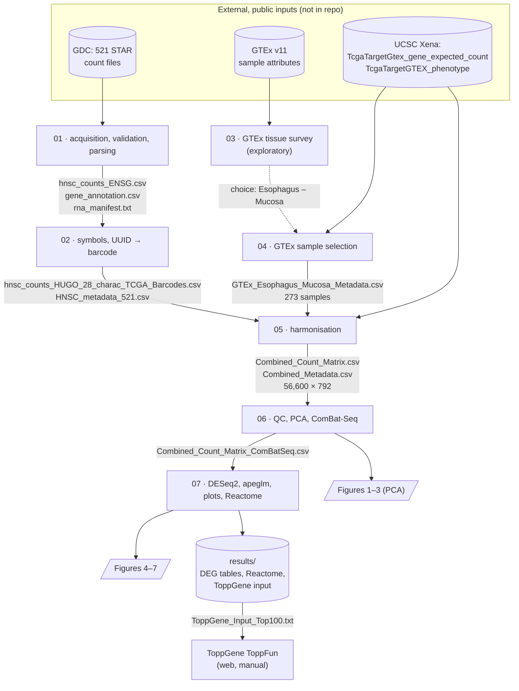

# Workflow and data flow

This page shows how the files move through the pipeline: which script reads what and writes what. Per-script detail is in [`src/README.md`](../src/README.md).

## Stage summary

| Stage | Script | Samples | Genes | Key result |
|---|:-:|---:|---:|---|
| TCGA parsed | 01 | 521 files | 60,660 | All files validated |
| TCGA cohort | 02, 05 | 519 | 60,660 → 60,616 | 2 metastatic excluded; 44 duplicate IDs removed |
| GTEx cohort | 04, 05 | 273 | 60,498 | Xena TOIL recompute |
| Combined | 05 | 792 | 56,600 | Gene intersection |
| Filtered | 06, 07 | 792 | 52,568 | Row sum ≥ 10 |
| Batch-corrected | 06 | 792 | 56,600 | PC1 70% → 47% |
| DE tested | 07 | 792 | 52,568 | 20,618 significant (630 up / 19,988 down) |
| Reactome | 07 | — | 1,934 Entrez | 127 pathways |
| ToppGene | manual | — | 98 symbols | ECM / integrin terms lead |

## Notes on running

1. The scripts were run interactively. Run them in numeric order, each from the directory that holds its inputs, as described in [`src/README.md`](../src/README.md).
2. Decompress `TcgaTargetGtex_gene_expected_count.gz` before script 05.
3. Edit the hard-coded `setwd()` on line 12 of script 07.
4. ToppGene is a manual web step: upload [`results/ToppGene_Input_Top100.txt`](../results/ToppGene_Input_Top100.txt) to <https://toppgene.cchmc.org/enrichment.jsp>. Results may differ from the 14 July 2026 run as ToppGene's annotation databases are updated.
5. Memory: the Xena expected-count matrix is about 8 GB uncompressed, so script 05 reads only the needed columns. Several intermediate CSVs exceed 100 MB, and the DESeq2 normalised-count table is about 425 MB. None of these are stored in the repository.
