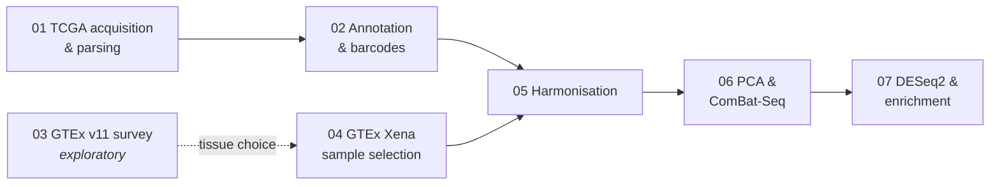

# Source code

These are the R scripts used for the internship analysis. They are **byte-for-byte the scripts that were run**. The analysis logic, parameters, thresholds and comments are untouched. The only change is the **filename**: each file now carries a numeric prefix for execution order and sits in a folder for its pipeline stage. Documentation lives in this file, not in edits to the scripts.

> [!IMPORTANT]
> The scripts were written and run **interactively in RStudio**. They are not a one-command pipeline. Most use paths relative to the working directory of the session, and several contain inspection lines (`head()`, `dim()`, `table()`). No `sessionInfo()` was recorded during the internship, so package versions are unknown. See [Known issues](#known-issues-documented-not-fixed) before re-running.

## Execution order and file mapping

| # | Path in this repo | Original filename | Stage |
|:-:|---|---|---|
| 01 | `data_acquisition/01_TCGA_GDC_Acquisition_Validation_Parsing.R` | `TGCA biolinks extracting & validation_Tanish .R` | TCGA download, validation, parsing |
| 02 | `data_acquisition/02_HNSC_Annotation_Metadata_Pipeline.R` | `HNSC_Annotation_Metadata_Pipeline.R` | Gene symbols, UUID → barcode, metadata |
| 03 | `data_acquisition/03_GTEx_Data_Preparation.R` | `GTEx_Data_Preparation.R` | GTEx v11 tissue survey (exploratory) |
| 04 | `data_acquisition/04_GTEx_Esophagus_Mucosa_Metadata_Preparation.R` | `GTEx_Esophagus_Mucosa_Metadata_Preparation.R` | GTEx sample selection (Xena) |
| 05 | `preprocessing/05_Data_Harmonization_and_Integration.R` | `Data_Harmonization_and_Integration.R` | Sample and gene harmonisation, combined matrix |
| 06 | `batch_correction/06_PCA_and_Batch_Effect_Analysis.R` | `PCA_and_Batch_Effect_Analysis.R` | QC, VST, PCA, ComBat-Seq |
| 07 | `differential_expression/07_DESeq2_Differential_Expression_Analysis.R` | `DESeq2_Differential_Expression_Analysis.R` | DESeq2, apeglm, plots, Reactome, ToppGene list |
| — | `exploratory/entrez_to_hugo.R` | `entrez_to_hugo.R` (identical copies: `codes_tanish.R`) | Early exploration, **not** used for reported results |

The header comment of script 07 refers to its upstream scripts by older working names: `01_Data_Harmonization.R` corresponds to **05** and `02_Preprocessing_BatchCorrection.R` to **06**.

---

## 01 · TCGA GDC acquisition, validation and parsing

**Purpose.** Turn a GDC manifest into a validated, gene × sample matrix of raw STAR counts for TCGA-HNSC.

| | |
|---|---|
| **Inputs** | `gdc_manifest.2026-06-18.143401.txt` (GDC portal manifest); the STAR files downloaded by `gdc-client` |
| **Steps** | Read the manifest (`TCGAbiolinks`) → filter to RNA-seq count files → write `rna_manifest.txt` → *(external)* `gdc-client download -m rna_manifest.txt` → find `*.augmented_star_gene_counts.tsv` recursively → validate (missing, extra, duplicate and unreadable files; per-file gene count) → read gene annotation from the first file → fill the matrix with the **`unstranded`** column → drop the 4 STAR summary rows → strip Ensembl version suffixes |
| **Outputs** | `rna_manifest.txt` (included in [`data/provenance/`](../data/provenance/)), `hnsc_counts_ENSG.csv`, `gene_annotation.csv` |
| **Validated state (report §5.1.2)** | 521 files; 0 missing, 0 extra, 0 duplicated, 0 unreadable; 60,660 genes in every file |
| **Packages** | `TCGAbiolinks` |

## 02 · HNSC annotation, barcode conversion and metadata

**Purpose.** Attach HUGO symbols, and replace file-UUID column names with TCGA barcodes so that sample metadata can be joined.

| | |
|---|---|
| **Inputs** | `hnsc_counts_ENSG.csv`, `gene_annotation.csv`, `rna_manifest.txt`, a GDC metadata table held in the R session as `metadata` |
| **Steps** | Prepend `HUGO` and `Ensembl` columns → build a file-UUID lookup from the manifest → POST to `https://api.gdc.cancer.gov/files` (`httr`/`jsonlite`) for `cases.samples.submitter_id` (16-character barcode) → rename columns → subset metadata to the 521 downloaded files → rename columns with the 28-character aliquot barcodes from `metadata$cases` |
| **Outputs** | `hnsc_counts_HUGO_1.csv`, `hnsc_counts_HUGO_2.csv` (16-character), `hnsc_counts_HUGO_3.csv` (28-character), `HNSC_metadata.csv`, `HNSC_metadata_521.csv` (included in [`data/provenance/`](../data/provenance/)) |
| **Packages** | `httr`, `jsonlite` |

## 03 · GTEx v11 data preparation (exploratory)

**Purpose.** Survey the GTEx v11 tissue list to choose a surrogate normal for head and neck mucosa, and inspect the v11 RNASeQC gene-reads release.

| | |
|---|---|
| **Inputs** | `GTEx_Analysis_v11_Annotations_SampleAttributesDS.txt`, `GTEx_Analysis_2026-05-19_v11_RNASeQCv2.4.3_gene_reads.gct.gz` (first rows only) |
| **Steps** | Tabulate `SMTS` and `SMTSD` → list candidate tissues (Esophagus – Mucosa, Esophagus – Muscularis, Esophagus – Gastroesophageal Junction, Minor Salivary Gland) → select **Esophagus – Mucosa** → preview the count file |
| **Outputs** | `gtex_selected_metadata.csv`, **not used downstream** |
| **Why not used** | The v11 release is quantified by GTEx's RNASeQC pipeline, which differs from TCGA's. The project instead used the UCSC Xena TOIL recompute, where both cohorts share one pipeline (273 samples instead of 1,366). See report §5.1.6. |

## 04 · GTEx Esophagus Mucosa metadata preparation (Xena)

**Purpose.** Select the GTEx Esophagus – Mucosa samples that exist in the UCSC Xena TCGA-TARGET-GTEx expected-count matrix.

| | |
|---|---|
| **Inputs** | `TcgaTargetGTEX_phenotype.txt.gz`, `TcgaTargetGtex_gene_expected_count.gz` (UCSC Xena) |
| **Steps** | Filter phenotype rows to `_study == "GTEX"` and `primary disease or tissue == "Esophagus - Mucosa"` → match the sample IDs to the matrix header |
| **Outputs** | `GTEx_Esophagus_Mucosa_Metadata.csv` (**273 samples**) |

## 05 · Data harmonisation and integration

**Purpose.** Build one combined count matrix and one metadata table with consistent sample IDs, a shared gene set and verified ordering.

| | |
|---|---|
| **Inputs** | `HNSC_metadata_521.csv`, `GTEx_Esophagus_Mucosa_Metadata.csv`, `hnsc_counts_HUGO_28_charac_TCGA_Barcodes.csv`, `TcgaTargetGtex_gene_expected_count` (uncompressed) |
| **Key parameters** | Keep `Primary Tumor` + `Solid Tissue Normal` (2 Metastatic excluded); truncate barcodes to **15** characters; strip Ensembl versions; drop duplicate Ensembl IDs, keeping the first (**44 removed**); intersect gene sets |
| **Steps** | Harmonised metadata (Sample_ID, Condition, Batch, Tissue, Study) → reorder the TCGA matrix to match → extract the 273 GTEx columns with `data.table::fread(select = …)` → gene harmonisation → intersect (**56,600** genes) → `cbind` / `rbind` → `stopifnot()` alignment checks |
| **Outputs** | `TCGA_Harmonized_Metadata.csv`, `GTEx_Harmonized_Metadata.csv`, `TCGA_Counts_Harmonized.csv`, `GTEx_Esophagus_Mucosa_Counts_Harmonized.csv`, `HNSC_Common_Genes_Counts.csv`, `GTEx_Common_Genes_Counts.csv`, **`Combined_Count_Matrix.csv`** (56,600 × 792), **`Combined_Metadata.csv`** (792 rows; included in [`results/`](../results/)) |
| **Packages** | `data.table` |

## 06 · PCA and batch-effect analysis (ComBat-Seq)

**Purpose.** Quantify the cohort batch effect, correct it with ComBat-Seq while protecting condition, and assess the correction.

| | |
|---|---|
| **Inputs** | `Combined_Count_Matrix.csv`, `Combined_Metadata.csv` |
| **Key parameters** | `design = ~1` for QC; filter `rowSums(counts) >= 10`; `vst(blind = TRUE)`; `ComBat_seq(counts = raw_counts, batch = Batch, group = Condition)` on **raw (rounded)** counts; `prcomp(center = TRUE, scale. = FALSE)` for PC3/PC4 |
| **Steps** | Pre-correction PCA (PC1 70%) → `table(Batch, Condition)` → ComBat-Seq → post-correction PCA (PC1 47%) → PC3 vs PC4 → identify the max-PC3 outlier (`GTEX-WFG8-1226-SM-5CHTQ`) → library-size checks |
| **Outputs** | `PCA_Before_BatchCorrection.{png,pdf}`, `PCA_After_BatchCorrection.{png,pdf}`, `PCA_PC3_PC4_AfterBatchCorrection.{png,pdf}`, **`Combined_Count_Matrix_ComBatSeq.csv`** |
| **Packages** | `DESeq2`, `sva`, `ggplot2`, `ggpubr` |

## 07 · DESeq2 differential expression and enrichment

**Purpose.** Test tumour vs normal on the corrected counts, shrink fold changes, produce the figures, and run Reactome enrichment. Also prepares the ToppGene input list.

| | |
|---|---|
| **Inputs** | `Combined_Count_Matrix_ComBatSeq.csv`, `Combined_Metadata.csv` |
| **Key parameters** | `design = ~ Condition`, reference `Normal`; filter `rowSums >= 10`; `lfcShrink(coef = "Condition_Tumor_vs_Normal", type = "apeglm")`; significance **`padj < 0.05 & abs(log2FoldChange) >= 2`**; `enrichPathway(organism = "human", pvalueCutoff = 0.05, pAdjustMethod = "BH", readable = TRUE)`; heatmap of the top 100 genes by padj, row-scaled; volcano labels for the 30 most significant genes; figures at 600 dpi |
| **Steps** | Load and verify sample order → DESeq2 → apeglm → normalised counts and MA plot → Ensembl → SYMBOL mapping (unmapped genes keep their Ensembl ID) → full and significant tables → volcano → VST heatmap → Ensembl → Entrez → Reactome ORA and bar chart → summary → ToppGene list (top 100 by padj, symbols only) |
| **Outputs** | `DESeq2_Normalized_Counts.csv`, `MA_Plot.{pdf,png}`, **`DESeq2_Results_All_Genes.csv`**, **`DESeq2_Significant_DEGs.csv`**, `Volcano_Plot.png`, `Heatmap_Top100_DEGs.png`, **`Reactome_Pathway_Results.csv`**, `Reactome_Barplot.png`, **`ToppGene_Input_Top100.txt`** (bold = included in [`results/`](../results/)) |
| **Packages** | `DESeq2`, `apeglm`, `ggplot2`, `ggpubr`, `ggrepel`, `pheatmap`, `clusterProfiler`, `ReactomePA`, `org.Hs.eg.db`, `scales` (namespace call) |

## exploratory · `entrez_to_hugo.R`

An early script, written before the GDC STAR route was adopted. It maps Entrez IDs to HUGO symbols (`org.Hs.eg.db::mapIds`) in a cBioPortal-format `data_mrna_seq_read_counts.txt` and writes `HNSC_counts_HUGO.csv`. **None of the reported results depend on it.** It is kept for completeness only.

---

## Known issues (documented, not fixed)

To preserve provenance, these are recorded here and not edited in the scripts.

| Script | Issue | Effect |
|---|---|---|
| 02 | `sum(rna_filename_uuid %in% uuid_cols)` refers to an undefined object; the variable defined above it is `filename_uuid`. | That inspection line errors; nothing downstream depends on it. |
| 02 | The object `metadata` (written to `HNSC_metadata.csv`) is never created in the script. The GDC metadata retrieval was done separately in the R session. | The script cannot produce `HNSC_metadata*.csv` on its own. The retained [`HNSC_metadata_521.csv`](../data/provenance/HNSC_metadata_521.csv) is provided instead. |
| 02 → 05 | Script 02 writes `hnsc_counts_HUGO_3.csv` (28-character barcodes), but script 05 reads `hnsc_counts_HUGO_28_charac_TCGA_Barcodes.csv`. | The file appears to have been renamed by hand between the two steps. |
| 04 → 05 | Script 04 reads `TcgaTargetGtex_gene_expected_count.gz`; script 05 reads the uncompressed `TcgaTargetGtex_gene_expected_count`. | The archive must be decompressed before script 05. |
| 04 | The final `read.delim(..., colClasses = ...)` call loads GTEx counts that are never saved. The counts used come from script 05's `fread`. | Redundant, memory-heavy step. |
| 06 | The low-count filter is applied before the pre-correction PCA (52,568 genes) but **not** re-applied after correction (56,600 genes). The PCA subtitles print `nrow(counts)` (56,600) in both cases. | Before/after variance percentages are approximately comparable, not exactly (report §5.4). |
| 07 | `setwd("D:/TANISH/COLLEGE/INTERNSHIP/HNSC/Tanish/checked files/Differential_Expression")` is hard-coded. | Edit or remove before running elsewhere. |
| 07 | In the ToppGene section, `head(top100_genes[, c("X", "Gene_Symbol")])` uses a column `X` that exists only when the significant-gene table is re-read from CSV. | In a fresh top-to-bottom run this inspection line raises "undefined columns selected". The output list is unaffected when run interactively. |
